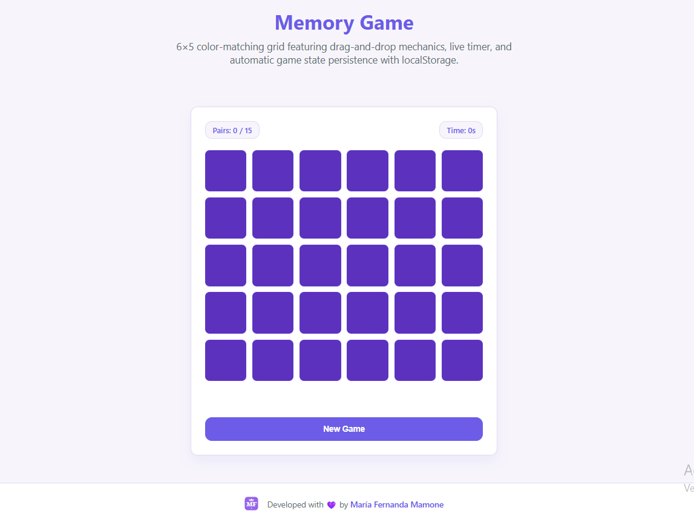

# Memory Card Game (OOP & Drag & Drop)

A 6×5 color-matching memory card game built with **Vanilla JavaScript (ES6+ OOP)**, **Vite**, **Modular Sass (SCSS)**, the **HTML5 Drag & Drop API**, and **`localStorage`** persistence.

[](https://mariafernandamamone.github.io/Memory-Card-Game-OOP/)

👆 **Click the preview image above to play the Live Demo!**

## Features

- **6×5 Color-Matching Grid:** 30 shuffled cards (15 distinct color pairs) rendered dynamically on the board.
- **Drag & Drop Gameplay:** Drag any card and drop it onto another to reveal both colors, with visual hover feedback (`.drag-over`) and automatic reset after 700ms on mismatch.
- **Object-Oriented Architecture:** Clean separation of responsibilities between `Box` (individual card state, DOM node, and drag events) and `Game` (board orchestration, pair matching, timer, and storage).
- **Live Timer & Pair Counter:** Tracks elapsed seconds from the first interaction and updates matched pairs (`0 / 15`) in real time.
- **Automatic Persistence (`localStorage`):** Saves board layout, matched cards, and elapsed time automatically so an in-progress game resumes seamlessly after a page reload.

## Project Structure

```
├── index.html
├── assets/
│   └── memory-card-game.png
├── public/
│   └── favicon.svg
└── src/
    ├── main.js
    ├── classes/
    │   ├── Box.js
    │   └── Game.js
    └── sass/
        ├── abstracts/
        │   └── _variables.scss
        ├── base/
        │   └── _base.scss
        ├── components/
        │   └── _board.scss
        └── main.scss
```

## Tech Stack

- **JavaScript (ES6+):** Classes, ES Modules, DOM Manipulation, HTML5 Drag & Drop API, Web Storage API (`localStorage`)
- **Sass (SCSS):** Modular architecture using `@use` and design variables
- **Vite:** Development server and production bundler

## Getting Started

1. Clone the repository:
```
   git clone https://github.com/mariafernandamamone/Memory-Card-Game-OOP.git
```

2. Install dependencies:
```
   npm install
```

3. Run the development server:
```
   npm run dev
```

## Author

Developed with 💜 by **María Fernanda Mamone**

- **Portfolio:** https://mariafernandamamone.github.io/Fernanda-Mamone-Portfolio/
- **LinkedIn:** https://www.linkedin.com/in/mfmamone/
- **GitHub:** https://github.com/mariafernandamamone
- **Email:** mailto:mariafrenchitas@gmail.com
